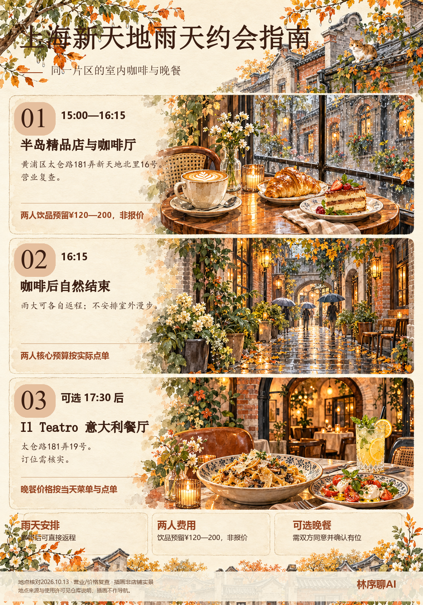
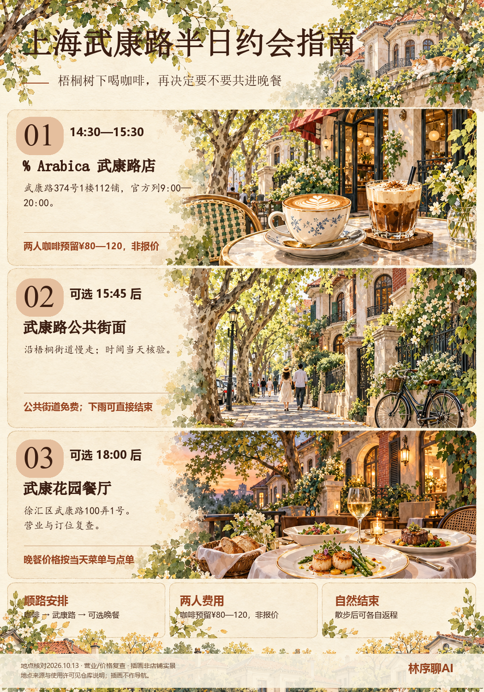

# Plan Date · 约会路线规划与指南海报

把第一次见面或半日约会，整理成三套有时间、预算、雨天备选与自然结束点的方案。仓库附有 **3 张示例海报、完整的插画提示词结构和固定排版脚本**，可以复现图片的文字布局。

> 三张示例使用已查到的真实街区和店铺，地点来源见[核验记录](examples/sources.md)。插画不是店铺实景或导航地图；营业、价格、订位和步行路线须在出发前再次核验。

## 示例图

| 北京五道营 | 上海新天地雨天 | 上海武康路 |
| --- | --- | --- |
|  |  |  |

## 能做什么

- 根据双方出发区域、时间和预算设计“轻松试探 / 半日交流 / 雨天室内”三套方案。
- 区分核心安排与双方同意后再延长的散步、晚餐。
- 将地点事实、预算估计和待核验项分开。
- 用固定模板输出带“林序聊AI”品牌标签的示意海报。

## 安装和复现

将仓库中的 `SKILL.md` 及 `references/` 放入支持 Agent Skills 的工具。若只想复现示例海报：

```bash
python -m pip install -r requirements.txt
python scripts/render_poster.py examples/first-meeting.json
python scripts/render_poster.py examples/rainy-day.json
python scripts/render_poster.py examples/half-day.json
```

模板目前使用 Windows 的宋体、楷体和微软雅黑。其他系统可在脚本顶部修改字体路径，选用支持中文与人民币符号的字体。海报数据在 `examples/*.json`，无字水彩画底在 `assets/`；修改 JSON 后重跑即可。地点依据与预算边界见[核验记录](examples/sources.md)，制作步骤见[海报生成流程](references/poster-workflow.md)，三张图的详细画底提示词见[插画提示词](references/illustration-prompts.md)。

## 来源与边界

本项目在城市导览地图的工作思路上参考了 [Hatari130/Map Creator](https://github.com/Hatari130/map-creator)：地点核验、地图与海报分离、示意图不能代替可核验地图。**本仓库没有打包、复制或运行 Map Creator 的 GIS 代码**。目前的三张示例由生图模型绘制无字水彩场景，再由本仓库的固定模板叠加中文文字；没有经过 GIS 底图渲染。

如果需要精确地图，可另行使用原版 Map Creator，并遵循它的 [MIT 许可](https://github.com/Hatari130/map-creator/blob/main/LICENSE)及所用地图数据、服务的条款。本仓库不提供地图服务 API、密钥或真实商家自动查询功能。

## 使用授权

个人学习、研究、测试及非商业使用免费。商业服务、收费产品、企业用途或商业分发，需要事先授权，联系 **linxu.money@gmail.com**。本仓库原创脚本与 Skill 使用 [PolyForm Noncommercial 1.0.0](LICENSE.md)；示例图片和文字按 [CC BY-NC 4.0](https://creativecommons.org/licenses/by-nc/4.0/) 提供。第三方项目各按自身许可证使用。详见 [商业授权说明](COMMERCIAL-LICENSING.md)。

## 隐私

示例数据只含公开商家地址，不含个人住址、私人联系电话、聊天记录、API Key 或真实个人行程。公开前请检查新填入的 JSON、图片元数据及提交历史，不要把私人地点或密钥提交到仓库。
